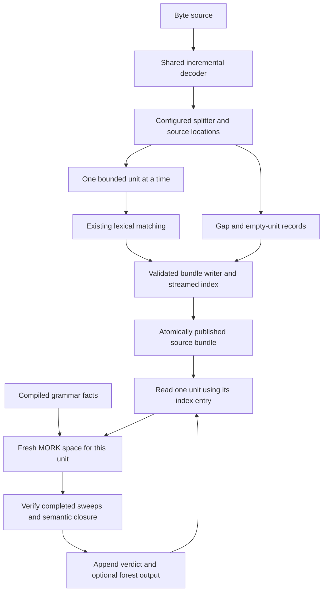

# Implementation plan: streaming splitting, token bundles, and MM2 Earley parsing

Written on 2026-11-09. This is the integrated next-step plan; it is not an
implementation report.

Updated 2026-11-10 to incorporate the
[revised span-forest plan](earley_span_forest_parser.md). That document supplies
the exact engine rules, forest identities/traversal, and regression requirements
for the Earley milestones here. The initial shared-helper implementation and
independent Claude assignments are recorded in the
[implementation handoff](claude_implementation_handoff.md).

## Objective and inputs

Process large text sources through configurable, bounded logical units, preserve
their decoded text and provenance, and recognize each unit with an MM2 Earley
engine. Keep the tools independent of application formats. Python 3.14 remains
the implementation environment for decoding, splitting, lexing, grammar
compilation, execution control, and forest traversal; Earley inference runs in
MM2.

This plan incorporates:

- Claude's [lexer implementation review](../../review_lexer_implementation.md),
  which accepts the existing lexer and its transport contract.
- Claude's [configurable splitter plan](../../detailed_plan_configurable_splitter.md).
- The [original Earley plan](../../detailed_plan_mm2_earley_parser.md) and
  [our runtime-backed review](../../review_detailed_plan_mm2_earley_parser.md).
- The actual implementation under [lexer/tokenizer](../../lexer/tokenizer/).

The existing lexer is the baseline to extend. The new scope is **a source
containing many independently processed token streams**, rather than one complete
source equaling one stream. Shared decoding, location tracking, record
validation, serialization, and consumers must all support that scope together.

This document supersedes conflicting scheduling, memory, manifest, and
reconstruction claims in the earlier plans. It leaves those documents as the
design and review history. No mbox, email, log, CSV, or other application-specific
behavior belongs in the engine. Demonstrations will use synthetic separators,
headers, and expression units.

## Decisions incorporated and corrected

| Earlier proposal | Integrated decision and reason |
| --- | --- |
| Keep splitting before the existing bounded lexer. | Adopt. One unit is assembled at a time, then passed through the existing matching algorithm. |
| Literal and regex separator/boundary specifications. | Adopt literals and a statically checked, bounded regex subset. Declaring a maximum consumed length alone does not bound regex context or prove streaming correctness. |
| Concatenation followed by re-encoding reproduces source bytes. | Guarantee exact decoded-text reconstruction. Generic decoding does not preserve the original byte spelling, BOM, or encoder state. |
| One bundle containing many streams. | Adopt, with a small summary manifest and a streamed index. Generated identities need no growing set; caller-owned identities have a fixed 100,000-pair cap. |
| Preserve single-stream output byte for byte while changing the manifest. | Preserve lexical decisions and `lex-*` version-1 facts. Introduce one version-2 bundle format for every writer and migrate its consumers together. The bundle envelope and manifest intentionally change. |
| Character-sized units automatically fit the parser. | Add a separate parser token limit and execution limits. Small character counts do not establish grammar-independent parse cost. |
| Load the resulting archive into MORK and parse its units. | Extract and parse one unit at a time in a fresh space. Retaining all units' token, item, or witness facts would defeat the memory bound. |
| Parser plan needs no changes. | Apply all three main Earley review corrections: closure before rejection, semantic convergence comparison, and bounded tree enumeration over a graph that may contain cycles. |

The recommendation is to ship bounded regex support with literals. If the first
release is explicitly narrowed to literals, defer the regex compiler milestone;
do not accept unchecked Python regexes as a substitute.

## Architecture and alternatives



The last arrow means advance to the next index entry, releasing the previous
unit's in-memory state and temporary runtime files. Persistent output files grow
with the source; working memory must not grow with the number of units.

| Choice | Selected approach | Alternative and tradeoff |
| --- | --- | --- |
| Boundary matching | Literal matching and validated finite-width regexes using Python's existing regex engine. | Arbitrary regexes need a substantially stronger context model. Literal-only support is smaller but cannot express the proposed variable headers. |
| Shared code | Add source and bundle capabilities to `tokenizer`; expose small shared helpers for `grammarc`. | A separate splitter package can import those helpers, but adds packaging work without a present independent consumer. |
| Metadata storage | Append `streams.jsonl`; use byte ranges to locate one stream in the two payload files. | One large JSON array requires careful streaming on every reader; one directory per unit creates excessive filesystem overhead. |
| Duplicate identity checks | Validate generated IDs from their namespace/base and consecutive index; cap the caller-owned identity set at 100,000 namespace/stream pairs. Fix one policy per source. | External sorting supports unbounded arbitrary IDs but adds staging and merge machinery without a current producer needing it. Defer it until that use case exists. |
| Parser execution | One fresh space per unit, initially rerun with increasing sweep budgets. | A persistent space could reduce startup costs but needs proven removal of every prior unit's derived facts. Defer until measurements justify it. |
| Parser completion | Compare complete semantic projections after additional complete sweeps. | A proved grammar-dependent bound is valid but not currently available; a measured constant is only an initial budget heuristic. |
| Forest output | Shared graph plus optional bounded enumeration. | Eager enumeration of all trees fails for unit cycles and grows exponentially for some acyclic grammars. |

Do not add parallel workers, resumable publication, a general boundary-state
machine, semantic actions, recovery, application grammars, or payload-free
transport profiles in this work. Splitting into independent units is appropriate
only when the chosen grammar does not require context across those units.

## 1. Shared foundations and migration

Extract and use shared mechanisms before introducing additional implementations
of them:

- `config.py`: duplicate-key detection, non-JSON-constant rejection, canonical
  JSON bytes, SHA-256 specification fingerprints, and flag-name validation.
  Lexical, split, and grammar schema validation remain distinct callers.
- `source.py`: an incremental decoded-chunk iterator. Migrate `read_stream()`
  to join that iterator so the existing finite-input API uses the same decoder.
  Preserve strict decoding, codec validation, byte-offset diagnostics, and
  pre-allocation limit checks. The iterator owns decoder state through final
  flush and must not normalize newlines.
- `location.py`, or the existing model helper if it remains small: one location
  algorithm shared by the whole-input lexer and incremental source processing.
  It must handle a CRLF pair across both decoder and unit boundaries.
- `serialize.py` and a focused `bundle.py`: keep one implementation of safe atom
  checks, chunk encoding, record checks, and atomic publication. Add the source
  envelope and indexed multi-stream archive there.

The source iterator accepts an optional total-byte/character ceiling. A missing
ceiling means unlimited total source size, not an unlimited unit. Zero continues
to mean an empty-only limit. Unit and parser limits remain finite.

Bound decoder state as well as input reads: reject a codec's pending undecoded
byte buffer above 64 KiB, including during finalization. Some incremental codecs
can retain an unfinished sequence without emitting characters, so unit limits
alone do not bound that storage. Keep byte reads at 64 KiB by default and test
pending-buffer exhaustion explicitly. This is a documented streaming limit,
not a claim that every possible codec has bounded state inherently.

The existing `tokenize()` operation still receives one complete bounded string
and produces its ordinary stream records. Introduce a source-record builder
that wraps one or more such streams in the new archive envelope; migrate every
serializer caller to that builder. Do not add an old-manifest output mode or
reader fallback. Unknown bundle versions receive a named configuration error.

Audit and migrate the CLI, library examples, fixtures, benchmarks, README, lexer
plan example checks, and serializer explainer in the same change. Retain the
current fingerprint values and exact `lex-*` projection as regression fixtures.

## 2. Split specification and exact semantics

Version 1 has exactly one of `separator` or `boundary`, a positive integer
`max_unit_chars`, and the policies below. Root and matcher objects reject unknown
fields and wrong exact types, including Boolean integers.

```json
{
  "version": 1,
  "separator": {"literal": "\n"},
  "retain": "end",
  "empty_units": "keep",
  "max_unit_chars": 65536
}
```

```json
{
  "version": 1,
  "boundary": {
    "pattern": "^UNIT [0-9]{4}: ",
    "max_length": 11,
    "flags": ["MULTILINE"]
  },
  "preamble": "unit",
  "empty_units": "keep",
  "max_unit_chars": 1048576
}
```

The second matcher consumes exactly 11 characters. A match starts a unit and is
included in that unit's text. Neither example identifies an application format.

| Policy | Definition |
| --- | --- |
| Separator matching | Choose the earliest nonoverlapping match. The next search begins at its end. |
| `retain: "end"` | Include the separator in the unit it closes; this is the separator default. |
| `retain: "gap"` | Emit the preceding unit and then a gap containing the exact separator text. |
| Boundary matching | Each match start begins a new unit. Search resumes after that match, so overlapping headers are not separate boundaries. |
| `preamble: "unit"` | Nonempty text before the first boundary is a unit; this is the boundary default. |
| `preamble: "reject"` | Nonempty preamble is an error with source coordinates. |
| `empty_units: "keep"` | Emit an empty candidate as an ordinary zero-token stream. |
| `empty_units: "drop"` | Emit a dropped-empty record at that source position; do not allocate a stream ID or discard nonempty text. |
| End of source | Emit a nonempty residual unit. Do not invent an extra empty unit solely because the last separator ended at EOF. An empty source has one empty candidate, governed by `empty_units`. |

`retain` is valid only for separator specifications; `preamble` only for boundary
specifications. Literals are nonempty and accept no regex-only fields. No match
means the entire source is one bounded candidate; an oversized source then
raises a limit error instead of being silently divided. With preamble rejection,
a nonempty source without a boundary is an error.

For separator `\n`, text `a\n\nb\n` produces `a\n`, `\n`, `b\n` with retention
at the end. With gap retention it produces units `a`, empty, `b`, interleaved
with three newline gaps. There is no fourth unit. These are contract fixtures,
along with leading separators, adjacent separators, and empty input.

### A provable regex subset

`max_length` bounds characters consumed, but assertions can inspect characters
they do not consume. For example, `a(?=b{100})` consumes one character while
requiring another hundred. A check of observed match lengths cannot discover
matches that a too-small window missed.

For the first implementation, permit literals, character classes, concatenation,
alternation, groups, optional pieces, and finite bounded repeats. Reject
unbounded repeats, lookahead, lookbehind, backreferences, conditionals, word/end
assertions, and unsupported operations. Permit a single leading `^`, interpreted
at real source start or after LF under `MULTILINE`; reject embedded anchors.
An overall minimum consumed width of zero is invalid.

Isolate a small validator around the pinned CPython 3.14 `re._parser` syntax
tree. Walk every nested operation using an explicit allowlist; a width query
alone is insufficient. Compute minimum and maximum consumed widths and require
the maximum to be no larger than the declared `max_length`. Reject oversized or
unbounded declarations before accessing the source. Compile the accepted pattern
through `re.compile()` for matching. Keep a runtime positive-length/width check
as an invariant assertion using explicit exceptions.

Cap the declared boundary window at 65,536 code points for this release, applying
the same cap to literal length. Larger windows are configuration errors. This
keeps the required lookahead explicit even when the unit limit is much smaller.

This uses a private CPython interface. Isolate it, test it on the required
interpreter, reject unknown operations, and qualify future Python updates before
supporting them. It avoids writing a second regex parser. The ordinary lexical
regex compiler retains its current broader behavior because it sees a whole
unit. Python's documented anchor and assertion semantics explain the distinction.
See the [Python 3.14 regex reference](https://docs.python.org/3.14/library/re.html).

The splitter uses Python's ordered alternation and greedy/non-greedy choices
within an accepted pattern; it does not redefine those as longest matching.
Bounded syntax establishes a context bound, not a linear-time guarantee for
all backtracking patterns. Specifications remain trusted configuration.

## 3. Streaming algorithm, preservation, and provenance

Define `U` as the configured maximum unit length in decoded code points, `W`
as the maximum boundary-match width, and `C` as the decoded chunk size held by
the splitter. Their sum describes text-buffer storage, not total output size.

1. Decode incrementally and retain decoder state across reads. Track total
   source bytes and decoded code points without buffering the source.
2. Maintain a search cursor with absolute source offsets. Before EOF, decide a
   candidate only when all `W` characters that could affect its match are
   available. At EOF, resolve the remaining candidates against the final tail.
3. Keep the actual preceding character for leading multiline anchors and the
   true source-start flag. Buffer compaction must not make `^` match a false
   new beginning. Call the matcher at candidate positions in that context.
4. Advance the cursor permanently past decided nonmatches. Do not repeatedly
   search the whole accumulated unit after every small read. Retain only the
   undecided suffix plus required preceding context in the search buffer.
5. Accumulate unit pieces separately until a genuine boundary is known. Apply
   retention and empty-unit policies, assemble at most one unit string, and
   feed it directly to the lexer and writer. Gap payloads are also emitted in
   bounded pieces if needed.
6. Check the unit limit as soon as excess text is known to belong to that unit.
   Pending boundary decisions may require up to the additional window before
   that determination. Exceeding the limit is an error; never cut a record to
   fit. Release processed pieces before continuing.

Text storage is proportional to `U + W + C`, allowing bounded temporary copies
when joining a unit. Fixed metadata buffers are accounted for separately. The
invariant is independent of total file size and total unit count.

### What reconstruction guarantees

Reassemble the JSON records in source order. Within each unit, concatenate token
and skipped lexemes; between units include the recorded gaps. The result must
equal the exact decoded source string, including CR, LF, Unicode, and trailing
text. Dropped-empty records contribute no characters but preserve the decision
that an empty candidate existed.

Do not promise byte-for-byte recovery after arbitrary re-encoding. Locally,
big-endian UTF-16 bytes `fe ff 00 41` decode to `A`, while encoding that string
with this machine's generic `utf-16` codec produces `ff fe 41 00`. Exact byte
archival requires retaining the original bytes and is outside this change.
This agrees with the distinction between decoding and encoding in the
[Python codec documentation](https://docs.python.org/3.14/library/codecs.html).

### Coordinates survive unit boundaries

Every source piece has an ordinal and a half-open absolute code-point span.
Every emitted unit also records its start/end source line and column, its unit
index, and the boundary context needed for CRLF handling. Token indices and
`lex-span` offsets remain local to their stream.

Absolute character offset is unit start offset plus local character offset.
Line and column mapping must use the shared location algorithm and recorded
context. It must not rely exclusively on `unit_start_line + local_line - 1`.
A unit ending after CR but before LF otherwise counts a line break differently
from the original source. The current whole-input lexer deliberately counts
CRLF at LF.

Keep one-character lookahead, or an equivalent pending-CR state, while counting
source locations. For error translation, scan the bounded unit prefix with its
source-start location and end context. Report both local and absolute positions;
do not require a source-sized line-offset table. Add fixtures with a boundary
between CR and LF, a boundary midway through a line, and multibyte characters
split across byte reads.

## 4. A bounded-memory source bundle

### One archive format and explicit completion levels

All bundle writers emit bundle version 2, including the no-split CLI path.
`lex-*` facts remain transport version 1. Preserve the existing caller-supplied
stream ID for a single unsplit stream; split streams use derived IDs below.
This distinction reflects the requested operation, not a legacy format mode.

Use one source envelope with this record order:

```text
SourceStart
  UnitStart, StreamStart, (Token or Skipped)*, StreamEnd
  Gap or DroppedEmpty records as dictated by source order
  ... further units and intervening records ...
SourceEnd
producer exhaustion
```

`UnitStart` supplies provenance and a unit identity. Existing stream records
retain their lexical meanings. Source spans of units and gaps partition the
decoded input; zero-length records are explicitly ordered. The shared checker
validates both per-stream invariants and this outer ordering.

Hold a stream end until its boundary is confirmed by the next valid outer
record. Hold `SourceEnd` until the producer finishes normally and required global
identity checks have succeeded. Missing ends,
extra records after the source end, or producer exceptions must not result in
a completed source. A stream end means that unit finished; it does not claim
the whole source finished. Raw iterators may expose a partial prefix; the
directory writer publishes only a fully validated bundle.

### Fixed file count, streamed metadata

| File | Contents and use |
| --- | --- |
| `tokens.jsonl` | Source envelope, unit provenance, lexical records, exact gap text, and dropped-empty decisions in source order. |
| `tokens.mm2` | Ordinary `lex-*` facts plus source/split metadata and completion facts. Raw lexemes never become syntax. |
| `streams.jsonl` | One small row per emitted stream: identity, ordinal, provenance, counts, and byte ranges locating that stream's records/facts in each payload file. |
| `manifest.json` | Version, source identity/encoding, runtime and specification fingerprints, aggregate counts, filenames, and final completion status. No array of streams. |

Write payloads as explicitly encoded bytes and count those bytes; text-stream
seek cookies are not portable byte ranges. Each indexed MM2 slice contains all
of one stream's `lex-*` facts and no scheduling code. A reader validates ranges,
identity, counts, catalog, fingerprints, and the stream's completion before
parsing it. The archive index is consumed row by row, never with `read_text()`
or `list()` over the whole file.

Choose the identity policy once at the source-envelope boundary. For generated
IDs, verify the namespace/base, exact `<base>_u<index>` spelling, consecutive
emitted-unit indices, unit-count ceiling, and upfront identifier-length bound.
These checks require no growing set. A field claiming an ID is generated cannot
exempt an arbitrary spelling from validation.

For caller-owned IDs, track namespace/stream pairs in a set capped at 100,000
entries. Reject duplicates and raise a named limit error before adding a pair
beyond that cap. One source cannot mix generated and caller-owned IDs, which
could collide even if each policy passed separately. Measure the capped set's
actual memory. External sorting is deferred until an unbounded arbitrary-ID
producer requires it.

After EOF, finish identity validation, close every payload and index, write the
summary manifest, and publish with the existing `renameat2(RENAME_NOREPLACE)`
helper. Any late lexical, decoding,
identity, validation, or I/O failure publishes no bundle. Atomic publication
still means visibility at the final path, not an `fsync` durability guarantee.

### Identity and MM2 metadata

Split stream IDs are `<base>_u<decimal-index>`, where the index counts emitted
units, including kept empty units. Dropped-empty candidates receive source-piece
ordinals but no stream ID. Define a required finite runtime unit-count ceiling
via `--max-units`, initially 1,000,000,000. Reserve enough identifier characters
for every index below that ceiling before reading input. This supports pipes
whose eventual length is unknown. Exceeding the ceiling is a limit error.

The existing 32-character identifier rule still applies. Do not truncate or hash
IDs. Namespace/base pairs are caller-assigned; merging independent bundles must
also reject colliding derived stream identities. The first parser command
processes one bundle and does not merge archives implicitly.

For the following facts, `NS` is the namespace, `F` the whole-source ID, `I` an
emitted unit index, `I2` its successor, `S` its stream ID, `A`/`B` its absolute
character span, `N` the unit count, and `D0`/`D1` split-fingerprint halves:

```scheme
(split-stream NS F 1)
(split-spec NS F sha256 D0 D1)
(split-unit NS F I S)
(split-next NS F I I2)
(split-span NS F I A B)
(split-end NS F N)
```

Use the same source envelope for an unsplit bundle, omitting `split-spec` when
there is no split specification. The final `split-next` points to the sentinel
index `N`, which has no `split-unit` fact. Zero emitted units produce
`split-end ... 0` and no unit edges. A tiny MORK fixture will verify ordered
cross-unit queries; production parsing does not load the entire source archive
to demonstrate this property.

Gap payloads and dropped-empty records live in JSON, as skipped lexemes already
do. MM2 is not promised to reconstruct the whole original source from its token
facts alone. Source completion and the manifest agree on all aggregate counts.

## 5. Earley implementation with the review corrections

### Grammar compilation

Keep the original grammar JSON, tagged terminal/nonterminal facts, grammar IDs,
dot-successor facts, and the five seed/predict/scan/complete/accept rules. Import
the shared configuration and transport helpers. Validate production names,
references, exact schema types, start symbol, and terminals against the declared
kind catalog of each selected stream.

A grammar ID denotes one immutable compiled specification within an execution.
Reject conflicting definitions rather than relying on fingerprint facts to
prevent joins. Retain the worked example's pinned digest and 13-item result.
Grammar version 1 can continue rejecting epsilon productions as a deliberate
scope restriction. Nullable precomputation is not a prerequisite for correctness
of the repeated-sweep engine. Empty units therefore normally reject under a
non-nullable grammar; they are not silently removed by the parser.

### Execution and closure

`grammarc parse` consumes a completed version-2 token bundle. For each selected
unit, read its index entry, verify the selected data, assemble grammar facts,
token facts, demand, and round data, then invoke a fresh MORK process. Only one
unit's facts, canonical result set, and optional forest need to remain resident.

Start with a modest sweep budget and increase it, initially by doubling. The
initial choice affects performance only. A comparison includes canonical sets
of that unit's `item` and `accepted` facts, plus `node` and `part` in forest mode.
It excludes round tables, execution instructions, and instrumentation. Check the projected
sets for equality and the expected monotonic inclusion across runs.

Add an execution-completed marker scheduled after the requested final sweep.
Require that marker and absence of pending engine executions before accepting a
run for comparison. A successful process exit alone does not prove the intended
work ran. Test this with deliberately interrupted/short execution budgets.

Do not report rejection until closure is established. Record separately:

- `recognition`: accepted, rejected, or incomplete;
- `closure_complete`: whether all inference for this unit has stabilized;
- `forest_complete`: whether the requested graph is complete, or `not_requested`;
- `enumeration_complete`: whether requested concrete-tree enumeration exhausted
  all alternatives rather than hitting a limit, or `not_requested`.

A sound acceptance fact can establish acceptance before closure. If a later
limit stops the run, preserve that fact while marking closure/forest incomplete.
Without acceptance or established closure, the result is incomplete. Runtime or
malformed-bundle errors are diagnostics, not grammatical rejection.

Set explicit per-unit token, cumulative-time, round, dump-size, and process-memory
limits. Initially qualify a 512-token parser limit, 4,096-round maximum, and
30-second cumulative wall-time limit against the measured examples. Choose and
record process-memory/output ceilings in the first runtime milestone using the
actual binary; an unmeasured memory value is not a correctness or throughput
claim. Enforce those ceilings on the subprocess, not merely after loading a
large dump into Python. Increasing rounds must not reset the per-unit deadline.

Release each completed unit's space and temporary files before advancing.
Stream results to a staged result bundle with aggregate counts; do not create
one result directory or retain one Python object per source unit. A rejected or
incomplete unit can be recorded and processing can continue to the next unit.
A source-level format/I/O failure prevents publishing a completed result batch.

### Span forest and trees

Implement the `node`/`part` schema and full alternative identity from the revised
span-forest plan. Keep symbol nodes, production-prefix nodes, and alternatives
distinct, including cycles. Dot-zero prefixes are empty only when origin equals
end. A scan points to its predecessor prefix and token occurrence; a completion
points to its predecessor prefix and a production-specific child. Traversal of
that child expands only the named production. One start-symbol root for the
whole unit retains every accepting production alternative.

Concrete-tree enumeration is optional and bounded by count, depth, and the
shared per-unit deadline. Mark truncation explicitly; never suppress a cycle
and claim the forest is complete.
Recognition and graph output must support direct and indirect unit recursion.

Measure retained items, nodes, and parts separately from cumulative runtime
unification/write counters and any instrumented completion-join count. The
quadratic item bound does not establish quadratic sweep cost; ambiguous
completion can involve three input boundaries. Do not claim the conventional
Earley runtime bound for this repeated whole-space join implementation.

## 6. Commands and limits

Keep `python -m tokenizer` as the text-to-token entry point. Add `--split-spec`
and `--max-units`; preserve explicit `--encoding` and namespace/source identity.
In split mode, `max_unit_chars` comes from the split specification. An explicit
`--max-chars` is a total decoded-source ceiling, not a second ambiguous unit
limit. Without splitting, retain today's finite total-size defaults; with
splitting, total byte/character ceilings default to unlimited. Document the
distinction and retain optional finite ceilings for either mode.

From `parsing/`, planned command shapes are:

```bash
export PYTHONPATH="$PWD/lexer:$PWD/earley"

lexer/.venv/bin/python -m tokenizer \
  --spec lexer/specs/expression_demo.json \
  --split-spec lexer/specs/split_lines.json \
  --input lexer/examples/expression_units.txt \
  --namespace demo --stream-id expressions \
  --output-dir lexer/output/expression_units

lexer/.venv/bin/python -m grammarc parse \
  --grammar earley/specs/expression_demo.json --grammar-id expr \
  --tokens lexer/output/expression_units \
  --max-tokens 512 --max-rounds 4096 --timeout-seconds 30 \
  --output-dir earley/output/expression_units
```

The initial export is the repository-local import-path setup for these commands,
run from `parsing/`. Do not scatter `sys.path` edits through modules. Keep the
current `MORK` executable override. No command examples should depend on a
particular working directory without naming it.

Recognition-only loads `earley.mm2`; `--forest` loads `earley_forest.mm2`.
Never load both into one space. `--max-trees` and `--max-depth` bound requested
enumeration. Record the selected engine's digest in the result manifest.

The parser's primary input is a token bundle. A future raw-text convenience
command can compose existing APIs after this path works. Do not duplicate
tokenization inside `grammarc` now. Parser exit status is `0` when all requested
recognition/results completed successfully, `1` when at least one unit was
rejected and none was incomplete, `3` when any requested result is incomplete,
`2` for configuration/runtime/input failure, and `130` for interruption. Errors
take precedence over grammatical outcomes. Requested forest/enumeration limits
also make the command incomplete even if recognition accepted. An empty bundle
finishes with zero processed units and status `0`. Batch summary counts preserve
every per-unit status.

## 7. Implementation sequence and completion criteria

### Milestone 1 — lock the contracts and share existing mechanisms

Write the new source-record, bundle-version, boundary/EOF, identity, and limit
contracts as executable fixtures. Extract configuration, incremental decoding,
and location helpers; migrate existing callers. Run the existing 45-test lexer
suite before changes, then update only expectations affected by the declared
bundle-format migration. Preserve lexical behavior, digest values, and MM2
payload identity.

**Complete when:** the original finite-source tests still pass through the shared
decoder, stream-level facts match their baseline, and decoding/location errors
remain correctly positioned across every tested read size.

### Milestone 2 — multi-stream archive without unbounded metadata

Implement the source envelope checker, multi-stream serialization, streamed
byte-range index, bounded identity validation, and atomic publisher. Migrate
single-stream CLI/API examples, benchmark readers, docs, and fixtures together.

**Complete when:** multiple streams, repeated text, kept empty streams, gaps,
and dropped-empty records reconstruct correctly; generated IDs validate without
set growth; caller-owned IDs reject duplicates and enforce the cap at and one
past its boundary; mixed policies fail; byte ranges retrieve exactly one stream;
and late exceptions or interrupted publication leave no completed output directory. Verify real
MORK load/dump preservation on small fixtures.

### Milestone 3 — literal and bounded-regex splitting

Implement strict split-spec loading and fingerprints, the regex subset
validator, incremental matching, source provenance, and split facts. Wire
`--split-spec` into the existing CLI using the common source/bundle path.

**Complete when:** separator and boundary examples work without engine changes;
all accepted specs are chunk-invariant; units plus gaps reconstruct the decoded
input; and no test obtains a boundary by silently cutting at a size limit.

Required cases include:

- Every boundary offset across byte-read sizes starting at one, including UTF-8,
  UTF-16, multi-character separators, and CRLF.
- Empty source, no match, leading/adjacent/trailing separators, preamble policies,
  retained/dropped empties, exact-size units, and one-character overflow.
- Rejected lookahead/lookbehind/end assertions, unbounded repeats, zero-width
  alternatives, false declared widths, and unknown regex operations.
- Anchored headers after buffer compaction; CRLF split between units; line and
  column translation for errors after several units and gaps.
- Fixed-seed randomized reconstruction and comparison with a whole-string
  reference splitter using the same allowed matcher semantics.
- Source errors, decoder-finalization errors, and lexical failures near the end
  of a multi-unit input; no final source marker or published bundle on failure.

### Milestone 4 — grammar compiler and honest MM2 recognition

Implement `earley/grammarc` and the existing five-rule engine with an explicit
execution-completed marker. Add per-unit archive reading, resource limits,
canonical projection comparison, and the accepted/rejected/incomplete contract.

**Complete when:** worked expressions, left/right recursion, nested expressions,
wrong tokens, truncated input, multiple grammars/streams in small isolation
fixtures, and unproductive recursion behave as expected in real MORK. Promote
the review's 31-production unit chain into a regression: small budgets can be
incomplete, never falsely rejected. Projected 20-/40-round expression outputs
must agree even though their scheduling tables differ. Oversized-token units
must be reported without loading them into MORK.

### Milestone 5 — finite forests and bounded tree extraction

Add the six-rule span-forest engine, a graph serializer, and bounded enumeration.
Stream forest records/results to fixed-count output files and release each unit before the
next. Keep status flags for recognition, closure, forest, and enumeration
separate.

**Complete when:** the revised plan's expression, identical-child-production,
two-ambiguous-child, and multiple-start-production regressions produce exactly
their expected alternatives and trees; unit cycles produce finite cyclic graphs;
and depth/count/time limits produce explicit partial enumeration. Both engines
must produce identical canonical item and acceptance sets. Include Remy's
precedence/associativity example and two-size ambiguous-concatenation part counts.

### Milestone 6 — end-to-end scale evidence and documentation

Measure source decoding, boundary search, lexing, serialization/indexing, identity
validation, per-unit MORK startup/inference, and forest extraction separately.
Use fresh processes so peak memory is comparable. Include both token-dense and
long-token inputs and grammars with unit chains, right recursion, and ambiguity.

For the splitter/writer, compare progressively larger synthetic sources while
holding unit size fixed; also increase unit count with very short units to expose
metadata growth. An opt-in multi-hundred-MB or larger run records peak RSS,
throughput, output expansion, staging disk use, and cleanup time. Assert a fixed
qualified working-memory envelope, allowing allocator overhead, rather than
only measuring two convenient small examples.

For the parser, show that peak working memory remains bounded as unit count
grows with fixed per-unit inputs and limits. Record startup cost and full-join
cost separately; the first implementation may be slow for millions of tiny
units. That evidence can motivate bounded batching later without claiming it is
already implemented.

**Complete when:** both generic splitter demonstrations and the bundle-to-parser
command run from the documented setup; archive reconstruction and per-unit
verdicts match their oracles; limits and partial results are documented; and
scale measurements cover metadata, child-process memory, and disk as well as
text buffers. Base gigabyte estimates on these measurements, not on an assumed
universal megabytes-per-second figure.

## Proposed file changes

```text
parsing/
  docs/dev_plans/stream_splitter_and_earley_pipeline.md
  lexer/
    tokenizer/
      config.py                 shared strict JSON/fingerprint/flag helpers
      source.py                 incremental decode iterator and finite wrapper
      model.py                  source/unit/gap records and diagnostics
      location.py               shared location state, if warranted by size
      split_spec.py             split schema and compiled matcher
      split_regex.py            isolated bounded-regex validation
      splitter.py               incremental boundary and unit production
      serialize.py              common stream/fact/codec checks
      bundle.py                 envelope, byte ranges, bounded identity checks
      __main__.py               common CLI pipeline
    tests/                      retain and extend existing suites
    specs/                      generic split demonstrations
    examples/                   synthetic multi-unit inputs
    benchmarks/                 bounded-memory and output-size measurements
    docs/serialize_explainer.md  update for migrated archive behavior
  earley/
    earley.mm2
    earley_forest.mm2
    grammarc/
      spec.py                   grammar schema/compiler
      serialize.py              grammar and execution-control facts
      runner.py                 per-unit MORK orchestration and closure
      forest.py                 cyclic graph and bounded enumeration
      __main__.py               compile/parse CLI
    specs/
    tests/
    benchmarks/
    README.md
```

Keep files focused; combine very small helpers where separate modules would add
indirection without improving ownership. Generated data remains under ignored
output directories. This plan does not schedule implementation changes outside
the parsing project.

## Evidence checked during this integration

The current CPython 3.14.10 successfully exposes the regex syntax tree needed
for the bounded-subset validator. A local probe confirmed that consumed-width
queries ignore lookahead/lookbehind context and that slicing can change `^`.
It also demonstrated the UTF-16 re-encoding difference and CRLF coordinate
difference used above. Importing `sqlite3` failed because `_sqlite3` is absent;
the metadata design therefore makes no assumption that this optional module is
available.

These are targeted design checks, not a completed splitter or parser validation.
The earlier Earley review supplies its independently measured round-budget,
witness-cycle, and completion-join examples. Implementation starts with the
shared foundations and migrated bundle contract, then proceeds through the
milestones in order.
