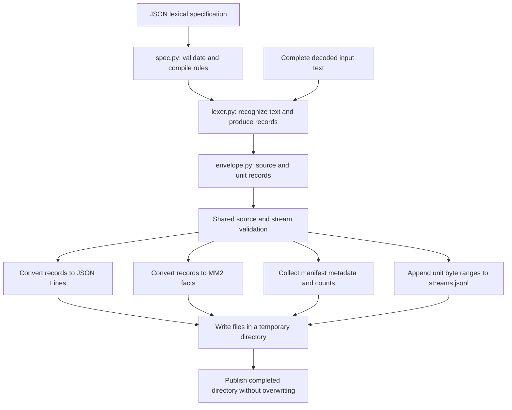

# How `serialize.py` works

[serialize.py](../tokenizer/serialize.py) provides token-record checks, reversible
text encoding, MM2 fact construction, and the atomic rename helper.
[envelope.py](../tokenizer/envelope.py) supplies source/unit construction and
sequence checks. [bundle.py](../tokenizer/bundle.py) combines them into version-2
archives and validated indexed reads. These modules share the algorithms
described here; serialization does not perform lexical recognition.

A **lexeme** is the exact text matched by a lexical rule, such as `12` or `+`.
An **MM2 atom** is one symbol, such as `INT` or `h3132`. An **MM2 fact** is a
parenthesized collection of atoms, such as `(lex-kind demo s0 INT)`.

The module receives tokens that have already been recognized. Its algorithms
organize and encode those tokens for storage and subsequent parsing.

## From lexical rules to output files



This diagram follows `write_bundle()`, which consumes the record sequence once
and produces all four output files. The separate `iter_jsonl()` and `iter_mm2()`
functions each check and consume their own supplied record sequence.

## The compilation steps

### Preparing the lexical specification

Compilation of user-supplied lexical rules happens in
[spec.py](../tokenizer/spec.py), before serialization starts:

1. `load_spec()` calls the shared `config.load_json()` to read a UTF-8 JSON file;
   `loads_spec()` uses `config.loads_json()` for supplied text. Both reject
   duplicate object keys and non-JSON constants such as `NaN`, then pass the
   decoded value to the lexical compiler.
2. `compile_spec()` checks the specification's structure. The version must be
   the integer `1`; rule names must be unique; each rule must have one matching
   method and one action.
3. `_compile_rule()` prepares each rule. A literal remains an exact string. A
   regex pattern becomes a reusable `re.Pattern` object through `re.compile()`.
   `config.compile_flags()` checks and combines requested flags before compilation.
4. Regexes are checked against empty input. A rule that immediately matches an
   empty string is rejected. The lexer later detects context-dependent empty
   matches that this preliminary check cannot discover.
5. The compiler collects the sorted, distinct terminal kinds declared by emitting
   rules. Skipping a match is represented by a rule whose `kind` is `None`.
6. The compiler calls `config.fingerprint()` to compute a SHA-256 fingerprint
   of the validated specification. It returns a `CompiledSpec` containing
   prepared rules, declared kinds, and that fingerprint.

The fingerprint uses the validated JSON representation with object keys sorted,
compact separators, and ASCII escaping. Array order is preserved, including the
rule order that resolves equal-length matches. The serializer receives this
fingerprint in `StreamStart`; it does not compile the rules again. The shared
[config.py](../tokenizer/config.py) helpers keep this recipe consistent for
future split and grammar specifications.

Here, compiling a regular expression means preparing an object that Python's
regex engine can use repeatedly. It does not generate an MM2 program. Ordinary
Python execution handles the module itself; there is no separate serializer
build command.

### Preparing the serializer's three validators

When Python imports `serialize.py`, these three `re.compile()` calls prepare
patterns used throughout serialization and decoding:

| Compiled pattern | Meaning | Where it is used |
| --- | --- | --- |
| `ATOM = re.compile(r"[A-Za-z0-9_-]+")` | One or more ASCII letters, digits, underscores, or hyphens. The final hyphen in the brackets is a literal character. | `checked_atom()` checks the spelling of every emitted MM2 atom. |
| `HEX_CHUNK = re.compile(r"h(?:[0-9a-f]{2}){1,24}")` | The letter `h`, followed by 1–24 pairs of lowercase hexadecimal digits. Each pair represents one byte. | `decode_lexeme()` checks each encoded chunk it receives. |
| `DIGEST = re.compile(r"[0-9a-f]{64}")` | Exactly 64 lowercase hexadecimal digits. | Metadata checks validate supplied specification fingerprints and payload digests. |

The `r` prefix marks a raw Python string, leaving any backslashes for the regex
engine to interpret. In `HEX_CHUNK`, `(?:...)` groups the two-digit unit without
capturing it as a separately returned match. `{2}` requires two digits, and
`{1,24}` repeats that unit between one and 24 times.

All three validators use `fullmatch()`: the entire supplied string must satisfy
the pattern. A valid prefix followed by extra text is insufficient. `ATOM`'s
regex checks characters and nonemptiness; the separate length check enforces the
63-character maximum. Since the allowed characters are ASCII, character count
and byte count are equal here.

These patterns validate transport data. They do not decide which lexical rule
matches the user's text.

## Checking one token stream: `StreamValidator`

The lexer produces four record types defined in [model.py](../tokenizer/model.py):

| Record | Information it contributes |
| --- | --- |
| `StreamStart` | Input identity, declared terminal kinds, specification fingerprint, and runtime metadata. |
| `Token` | One emitted token, its exact lexeme, token index, kind, rule, and source span. |
| `Skipped` | Text consumed by a skip rule, with its exact lexeme and source span. |
| `StreamEnd` | Final token count and decoded source length. |

The validator maintains counters and location state:

| Local variable | Meaning |
| --- | --- |
| `start` | The accepted `StreamStart`, initially absent. |
| `end` | The accepted `StreamEnd`, initially absent. |
| `token_count` | Number of emitted tokens accepted so far. |
| `char_count` | Number of source code points accounted for by tokens and skipped spans. |
| `skipped_count` | Number of skipped-span records. |
| `position` | Line and column calculated from the records' text, with a pending trailing CR when necessary. |

The first record must be `StreamStart`. Its namespace and stream ID must be valid
identifiers; its kinds must be valid names in a sorted, duplicate-free tuple;
and its fingerprint must have the expected 64-digit format. This fingerprint
check validates its shape, while the specification compiler supplies its value.

For every subsequent record, the validator checks that the namespace and stream
ID still identify the same input. A second start record is invalid. For each
token or skipped span:

1. The lexeme must be nonempty.
2. Its character start must equal `char_count`, so the records account for the
   source consecutively, without gaps or overlaps.
3. Its character end must equal that start plus the lexeme's code-point length.
4. `char_count` advances to the span's end.
5. For an emitted token, its index must equal `token_count` and its kind must
   belong to the declared catalog. Only then does `token_count` increase.

Skipped text advances the character count but does not advance the token count.
The validator checks rule names, strict Unicode text, and local line/column
coordinates as well as offsets. It derives coordinates from the supplied text;
it does not reread the original byte source.

`TextPosition` holds a trailing CR unresolved until the next character is known.
Before checking the next record's starting coordinates it resolves that CR:
before LF the CR advances a column, while at EOF or before another character
it starts a new line. The existing `advance_location()` performs the actual
counting. `UnitValidator` runs the same location algorithm from the unit's
absolute starting coordinates, using its recorded `following` character at the
end. Local token coordinates and absolute source coordinates can therefore
differ at a unit boundary inside CRLF without losing the original position.

## Checking the source envelope

`source_records()` accepts bounded `SourcePiece` values and constructs this order:

```text
SourceStart
  UnitStart, StreamStart, (Token or Skipped)*, StreamEnd
  Gap or DroppedEmpty, or another unit
SourceEnd
normal producer exhaustion
```

`SourceValidator` checks consecutive piece ordinals and verifies that unit/gap
spans cover the decoded source without overlaps or missing characters.
Dropped-empty records have zero-length spans and still consume an ordinal.
Each unit starts a `UnitValidator`; only after its valid `StreamEnd` can another
outer piece appear. Its stream must share the source's lexical fingerprint,
catalog, runtime identity, and encoding. Aggregate counts are checked against
`SourceEnd`.

The source fixes one identity policy. `IdentityTracker` checks generated names
against their exact base and consecutive index using constant state. For
caller-owned names it stores namespace/stream pairs in a set, rejects duplicates,
and refuses the 100,001st distinct pair. The configured unit ceiling also applies.
Generated and caller-owned IDs cannot mix within one source.

### Why the end record is held back

`checked_source_records()` holds a `StreamEnd` until the next valid outer
boundary. For example, a token immediately after a stream end is an error and
cannot release that stream's end marker. A valid next unit, gap, empty decision,
or source end can release it.

The source end is held until normal producer exhaustion. An exception or an
extra record after `SourceEnd` prevents source completion from being emitted.
Earlier unit ends may already have been emitted; they establish completion of
those units only. Missing stream/source ends are errors. The atomic writer
discards all staging output if any later record fails.

## Building safe MM2 facts: `checked_atom()` and `_fact()`

`checked_atom()` is the common check applied to every atom in an emitted fact:

1. An actual nonnegative Python integer becomes its decimal string spelling.
   The exact type test excludes Booleans, even though Python treats `bool` as an
   integer subclass.
2. The resulting value must be a string matching `ATOM` completely.
3. The string must contain at most 63 characters.
4. A failed check raises `OutputError`; a successful check returns the string.

Thus integer `12` becomes `12`, and the string `h3132` is accepted. A negative
integer, a Boolean, an empty string, an oversized atom, or text containing
parentheses, spaces, or dollar signs fails the check. This is a general atom
check; field-specific name and position constraints are enforced separately.

The length limit matters because the local non-interning MORK reader truncates
oversized input atoms. Two long values with a common prefix could otherwise
become equal inside MORK. This is an explicit runtime check and remains active
under Python's `-O` option.

`_fact()` checks every argument, joins the resulting strings with spaces, adds
outer parentheses, and appends a newline. For example:

```python
_fact("lex-token", "demo", "s0", 2, 3, "INT")
# Returns "(lex-token demo s0 2 3 INT)\n"
```

The producer selects the predicate names. Arbitrary lexeme text reaches a fact
only after the byte encoding described next.

## Encoding exact token text: `encode_lexeme()`

MM2 must be able to store text that contains spaces, parentheses, control
characters, or Unicode, as well as text longer than a single atom. The encoder
turns that text into a sequence of short, safe atoms:

1. Encode the entire lexeme as strict UTF-8 bytes. Invalid surrogate code points
   cause an `OutputError`.
2. Record the byte count.
3. Visit byte offsets 0, 24, 48, and so on. Each visit takes at most 24 bytes.
4. Convert the chunk to lowercase hexadecimal and prefix it with `h`.
5. Return the byte count and an iterator of `(chunk_index, encoded_atom)` pairs.
   Each chunk index is its starting byte offset divided by 24.

Hexadecimal uses two characters per byte. A full chunk therefore uses
`1 + 2 * 24 = 49` ASCII characters, including the prefix, within the 63-byte
atom limit. The prefix gives payloads a uniform spelling; it is removed during
decoding.

For `A😀B`, there are three Unicode code points and six UTF-8 bytes:

| Character | UTF-8 bytes in hexadecimal |
| --- | --- |
| `A` | `41` |
| `😀` | `f0 9f 98 80` |
| `B` | `42` |

The result is byte count `6` and one part, `(0, "h41f09f988042")`.

The iterator produces chunk atoms on demand, but the whole UTF-8 byte string
already exists in memory. This avoids retaining a list of all encoded chunks;
it does not provide constant-memory processing of an arbitrarily long lexeme.

### A chunk can divide a Unicode character

Consider 23 copies of `a` followed by `😀`. The lexeme has 24 code points but
27 UTF-8 bytes. Chunk zero contains the 23 ASCII bytes and the first emoji byte,
`f0`. Chunk one contains the remaining bytes, encoded as `h9f9880`.

The individual byte chunks are not necessarily valid UTF-8 strings. This is why
the decoder joins their bytes before attempting to recover characters.

## Reconstructing text: `decode_lexeme()`

The decoder accepts encoded parts in any order, together with `byte_count`, the
declared UTF-8 byte length, and `chunk_count`, the declared number of parts.
This is useful after retrieving facts from MORK, whose fact set does not preserve
the order in which they were written.

The expected number of chunks is:

```python
chunk_count = (byte_count + 23) // 24
```

This is integer division rounded upward: 24 bytes need one chunk, 25 bytes need
two, and zero bytes need none. The decoder checks that both counts are actual
nonnegative integers and that they agree with this formula.

It then processes each `(chunk_index, encoded_atom)` pair:

1. Require an integer index within the declared range, used exactly once.
2. Require the complete atom to match `HEX_CHUNK`.
3. Remove `h` and convert the remaining hexadecimal digits back to bytes.
4. Check the chunk's length: every nonfinal chunk must hold 24 bytes, and the
   final chunk must hold precisely the remaining declared bytes.
5. Store those bytes in a dictionary indexed by chunk position.

After all parts arrive, every declared position must be present. The decoder
joins chunks in numerical order and strictly decodes the combined bytes as UTF-8.
Duplicate indices, missing parts, bad hex, inconsistent sizes, and invalid UTF-8
produce `OutputError`.

The codec can round-trip an empty string using zero bytes and zero chunks.
The record validator independently forbids empty token lexemes.

Reassembly consumes the encoded parts supplied by its caller; this function does
not read or parse an MM2 file itself. Its size and encoding checks detect malformed
transport, but do not authenticate the text against the original input.

## Translating records: `_mm2_lines()`

This function converts one checked record into zero or more newline-terminated
facts. The table names every placeholder used in the fact shapes below:

| Placeholder | Meaning |
| --- | --- |
| `NS`, `S` | Dataset namespace and input occurrence ID. |
| `P`, `Q`, `K` | Token index, its successor, and the declared terminal kind. |
| `A`, `B` | Source character start and exclusive end. |
| `U`, `V` | Lexeme UTF-8 byte count and number of chunks. |
| `J`, `H` | Chunk index and encoded chunk atom. |
| `D0`, `D1` | First and second halves of the specification fingerprint, each prefixed with `h`. |
| `N`, `C` | Final token count and decoded source character count. |

| Input record | Emitted facts |
| --- | --- |
| `StreamStart` | `(lex-stream NS S 1)`, `(lex-spec NS S sha256 D0 D1)`, and one `(lex-kind NS S K)` per declared kind. |
| `Token` | `(lex-token NS S P Q K)`, `(lex-span NS S P A B)`, `(lex-value-size NS S P U V)`, and one `(lex-value-part NS S P J H)` per chunk. |
| `Skipped` | No MM2 facts. Its text is preserved in JSON Lines. |
| `StreamEnd` | `(lex-end NS S N C)`. |

The successor is computed in Python as the token index plus one. A future parser
can join on a known input position and read the next position directly. Token
indices also preserve repeated occurrences of the same text inside a fact set.

The `1` in `lex-stream` identifies transport contract version 1. The fingerprint
is 64 hex characters long, so it is split into two 32-character halves, each
prefixed with `h`. These 33-character metadata atoms retain the entire digest.
This fixed split is separate from the 24-byte lexeme-chunk algorithm.

The kind catalog describes the specification's declared kinds. An input that
contains no integer tokens can still declare `INT`. This lets future grammar
checks distinguish an unknown terminal name from one absent in a particular input.

## JSON Lines and the iterator wrappers

`_json_line()` uses `dataclasses.asdict()` to turn a record into a dictionary,
including its nested source span. `json.dumps()` then encodes it with:

- `ensure_ascii=True`, so non-ASCII characters and control characters are escaped
  while remaining exactly recoverable by a JSON reader;
- compact comma and colon separators;
- `allow_nan=False`, so non-JSON floating-point values cannot be emitted.

A newline terminates each record. A newline inside a lexeme is escaped within
the JSON string, so it does not create a second physical record line. Skipped
spans retain their text here. Concatenating emitted and skipped lexemes plus gap
text in source order reconstructs the decoded input.

`iter_jsonl()` in `bundle.py` checks the Python version, passes the source
envelope through `checked_source_records()`, and yields one JSON line per
accepted record. `iter_mm2()` does the same validation, uses
`_source_mm2_lines()` for source/unit facts, and delegates ordinary lexical
records to `_mm2_lines()`.
Both are generators: their bodies start when a caller requests output, and
errors may arise during iteration.

A record generator is single-use. Passing the same generator first to one
serializer and then to the other leaves the second with no records.
`write_bundle()` handles both formats in one pass instead.

## Worked example: `x + 12`

Use [expression_demo.json](../specs/expression_demo.json), namespace `demo`, and
stream ID `s0`. This example's input has exactly six characters, with no trailing
newline:

| Source span | Exact text | Result | Token index |
| --- | --- | --- | --- |
| `[0, 1)` | `x` | `IDENT` | 0 |
| `[1, 2)` | one space | skipped | none |
| `[2, 3)` | `+` | `PLUS` | 1 |
| `[3, 4)` | one space | skipped | none |
| `[4, 6)` | `12` | `INT` | 2 |

The complete MM2 serialization of an unsplit source also named `s0` is:

```scheme
(split-stream demo s0 1)
(split-unit demo s0 0 s0)
(split-next demo s0 0 1)
(split-span demo s0 0 0 6)
(lex-stream demo s0 1)
(lex-spec demo s0 sha256 habcfb5fed40800240f2db2a33558d2a4 he0c7010c6b165172b8554beda8ddcbc3)
(lex-kind demo s0 ASSIGN)
(lex-kind demo s0 EQ)
(lex-kind demo s0 IDENT)
(lex-kind demo s0 INT)
(lex-kind demo s0 PLUS)
(lex-token demo s0 0 1 IDENT)
(lex-span demo s0 0 0 1)
(lex-value-size demo s0 0 1 1)
(lex-value-part demo s0 0 0 h78)
(lex-token demo s0 1 2 PLUS)
(lex-span demo s0 1 2 3)
(lex-value-size demo s0 1 1 1)
(lex-value-part demo s0 1 0 h2b)
(lex-token demo s0 2 3 INT)
(lex-span demo s0 2 4 6)
(lex-value-size demo s0 2 2 1)
(lex-value-part demo s0 2 0 h3132)
(lex-end demo s0 3 6)
(split-end demo s0 1)
```

Read the last token's facts together: at token position 2, an `INT` advances to
position 3; its source characters occupy `[4, 6)`; its text has two UTF-8 bytes
in one chunk; hexadecimal `31 32` decodes to `12`. The end fact records three
tokens from six characters.

The corresponding JSON token record is:

```json
{"namespace":"demo","stream_id":"s0","index":2,"kind":"INT","rule":"integer","lexeme":"12","span":{"char_start":4,"char_end":6,"line_start":1,"column_start":5,"line_end":1,"column_end":7},"type":"token"}
```

The JSON output additionally contains the two skipped-space records, source and
unit provenance, stream metadata, and both completion records. Source columns are one-based, explaining
why character offset 4 corresponds to column 5.

## Publishing the bundle: `write_bundle()`

The writer in `bundle.py` creates `tokens.jsonl`, `tokens.mm2`, `streams.jsonl`,
and `manifest.json` through this sequence:

1. Check Python 3.14 and make the destination path absolute.
2. Refuse a destination that already exists. `os.path.lexists()` also detects
   a dangling symbolic link.
3. Create any needed parent directories, then a uniquely named temporary sibling
   directory beside the destination.
4. Open the payloads and index as binary files in the staging directory.
5. Consume `checked_source_records()` once. Encode each accepted record to bytes,
   then write those bytes and update byte counters and SHA-256 digests.
6. At `UnitStart`, remember the JSON position before its provenance record.
   At `StreamStart`, remember the MM2 position after the source-unit facts.
   At `StreamEnd`, append an index row with both end positions, provenance,
   catalog, fingerprint, and counts. Retain only the current unit's metadata.
7. Merge the source start/end metadata into a small summary manifest. Close all
   three data files, add their lengths/digests to the manifest, and write it.
8. Rename the entire temporary directory to the requested destination using
   `publish_directory()`.
9. Return the manifest mapping to the caller.

The skipped-span count counts matches of skip rules, not skipped characters.
One regex match consuming several spaces contributes one skipped span.

Index ranges are half-open byte offsets, measured from the encoded bytes written
to binary files. They are not text-stream seek cookies or character offsets.
The JSON slice includes unit provenance and a complete ordinary stream; the MM2
slice contains only that stream's `lex-*` facts. Gaps and source metadata remain
outside the indexed slices. A final `split-next` edge points to the unit-count
sentinel, which has no corresponding `split-unit` fact.

### Why the final rename has its own helper

The early existence check provides a prompt error, but another process can create
the destination during tokenization. `publish_directory()` uses Linux
`renameat2` with `RENAME_NOREPLACE`, asking the operating system to perform the
rename only if the destination is still absent.

`ctypes.CDLL(None, use_errno=True)` provides access to the process's C-library
symbols and error number. The helper locates `renameat2`, declares its C argument
and return types, and passes the two filesystem paths as bytes. The flag value
`1` selects `RENAME_NOREPLACE`. The directory-descriptor value `-100` denotes
`AT_FDCWD`; these calls use absolute paths, so those descriptors do not affect
path resolution.

A zero return value means success. On failure, the helper reads the operating
system error number and raises `OSError`; `write_bundle()` translates that into
`OutputError` with destination context. An unavailable `renameat2` produces an
explicit `OutputError`. The operating system and filesystem must support this
operation. Its behavior is described in the
[Linux rename documentation](https://man7.org/linux/man-pages/man2/rename.2.html).

This gives readers atomic visibility of the completed directory at the requested
destination. The files are closed before publication; explicit filesystem
durability synchronization with `fsync` is not implemented.

### Failure and cleanup

If lexing, validation, or writing raises an exception before publication,
the temporary-directory context cleans up its staging files. Lexical and
configuration errors from the upstream generator propagate to the caller.
Output-related operating-system errors are wrapped as `OutputError`.
Parent directories created earlier may remain.

The lower-level line iterators do not provide this publication behavior: a caller
writing their yielded lines directly can retain a partial prefix after an error.
The caller must either consume successfully through completion or use the bundle
writer's publication mechanism.

## Reading the archive: `BundleReader`

The constructor reads a bounded manifest, rejects versions other than 2, checks
its exact schema and fixed fields, and checks the named payload file sizes.
It does not load the whole archive.

`iter_entries()` reads one bounded index line at a time, checks its identity,
counts, source metadata, increasing positions, and nonoverlapping byte ranges.
After normal exhaustion it verifies the index digest and aggregate counts.

`read_stream()` first applies the caller's token, character, and encoded-byte
limits to the selected entry. It then reads only its two ranges. The JSON records
pass through the same `UnitValidator` used by the writer. Regenerating their
lexical facts and comparing bytes with the MM2 slice rejects missing, extra,
reordered, or changed facts. No general MM2 code parser is needed because the
bundle writer supplies a canonical ground-fact format. The result contains one
unit's metadata, ordinary records, and MM2 bytes.

`iter_records()` performs full archive verification while streaming its JSON
records. It compares regenerated source/lexical facts with the MM2 file, verifies
index ranges at unit boundaries, and compares the final source counts and all
three payload digests with the manifest before yielding `SourceEnd`.
Selected-unit reads do not establish whole-archive integrity or inspect
unselected units. Even full verification checks consistency with the recorded
digests; it does not authenticate the original producer.

## Memory use and checks to explore

Generated-identity checking stores counters, source/current-unit metadata, and
one pending end record. Caller-owned identities additionally use a set capped at
100,000 pairs. The writer appends index rows without retaining previous rows.
Full archive reading checks identities in both the source and index sequences,
so caller-owned inputs can hold two such capped sets. Serialization still
needs memory for the current record: UTF-8 encoding allocates the current
lexeme's bytes, and JSON encoding constructs one complete output line.
Decoding retains all supplied chunks and joins them into a complete value.
The upstream lexer holds one complete bounded unit; the unsplit CLI holds its
complete finite input. `read_stream()` retains one selected unit's parsed records
and encoded payload. Its byte/token/character ceilings bound that allocation.

To exercise the described behavior from the `lexer/` directory:

```bash
.venv/bin/python -m unittest tests.test_serialization tests.test_bundles tests.test_mork -v
.venv/bin/python -m benchmarks.bundles
```

[test_serialization.py](../tests/test_serialization.py) checks the exact worked
example, encoding boundaries, Unicode round trips, corrupt chunks, incomplete
streams, optimized-mode atom checks, and publication failures.
[test_mork.py](../tests/test_mork.py) loads the generated facts into the actual
MORK runtime and checks adjacency, completion, metadata, repeated tokens, and
preservation of long or structurally significant text.
[test_bundles.py](../tests/test_bundles.py) exercises source reconstruction,
empty decisions, CRLF boundaries, identity policies/caps, indexed reads,
corruption, and completion failures. The bundle benchmark measures growing unit
counts in fresh processes and records capped-set allocation separately.
